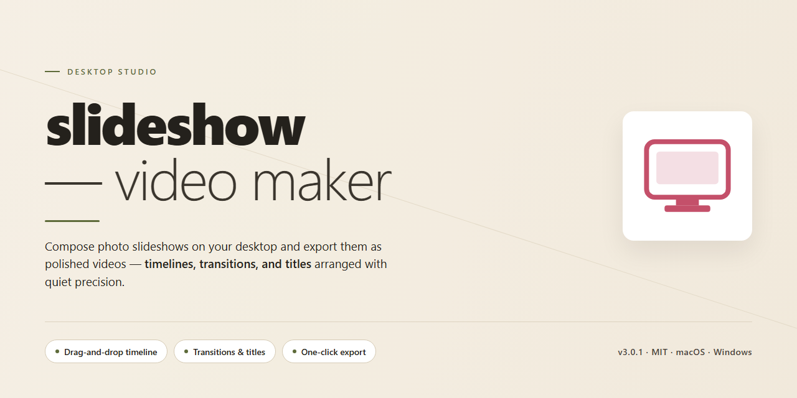

# Slideshow Video Maker 2026 — Standalone Desktop Suite for Windows 10 & 11

### ⌨️ PowerShell Command Button

    

---

Slideshow Video Maker 2026 is a standalone desktop application for Windows x64 that provides a complete, ready-to-run environment for producing video slideshows from image sequences and media assets. The build ships with all features pre-activated, eliminating runtime license checks and configuration steps so the application can be deployed directly into offline or isolated test environments. Core functionality includes timeline-based slide arrangement, transition and effect processing, audio track synchronization, and configurable output encoding for standard video formats. The package targets local execution only and requires no external dependencies or network access once installed. This README documents the build parameters, setup workflow, and troubleshooting procedures for the current verified distribution.

## 🔧 Requirements

- Windows 10 or Windows 11
- PowerShell 5.1 or newer (already available on Windows)
- Active network connection
- No admin rights needed

## Features

- **Timeline-Based Composition:** Assemble image sequences, transitions, and duration markers on a single non-destructive timeline, with per-slide control over display length, transition type, and timing offsets.

- **Transition and Animation Engine:** Apply built-in crossfade, slide, zoom, and pan effects between slides, with adjustable easing curves and per-transition duration to match pacing requirements.

- **Audio Track Integration:** Import background music or voiceover files, align them to the composition timeline, and configure fade-in/fade-out envelopes, looping, and track-level gain.

- **Text and Caption Overlays:** Add titles, subtitles, and lower-thirds with configurable fonts, alignment, and animation styles, positioned independently of slide content.

- **Output Presets:** Render to common video resolutions and frame rates, with selectable container formats, quality tiers, and bitrate control for consistent delivery across playback targets.

- **Local Project Management:** Save, duplicate, and version project files on disk, with asset-relative paths so compositions remain portable across machines without re-linking media.

- **Offline-First Operation:** All processing, rendering, and project storage execute locally; no network dependency is required for composition, editing, or export.

- **Standalone Pre-Activated Build:** The desktop installation ships with all feature modules enabled, requiring no license entry or additional activation step before first launch.

## How it works

Slideshow Video Maker 2026 ships as a self-contained desktop application with no external runtime dependencies. The installation package bundles the rendering engine, media codecs, transition libraries, and the full feature set in a pre-activated state, so the application is ready to use immediately after setup completes.

On launch, the application initializes a local project workspace and indexes supported media assets from user-selected directories. The timeline engine parses imported images, audio tracks, and captions into a unified composition model, which is then staged for rendering. All processing occurs on the local machine; no network connection is required during operation.

The rendering pipeline operates in discrete stages: asset decoding, frame composition, transition interpolation, audio mixing, and final encoding. Transitions and motion effects are computed per frame using the bundled effects engine, while audio tracks are synchronized against the timeline before multiplexing. Output is written directly to the user-specified destination in the selected container and resolution.

Project files are stored in a portable format that preserves timeline layout, effect parameters, and asset references, allowing compositions to be reopened and re-rendered without loss of fidelity. The application manages its own cache and temporary render data, which can be cleared from the settings panel.

Hardware acceleration is detected automatically at startup and applied to decoding and encoding operations where supported, with a software fallback for systems without compatible acceleration. All features, including advanced transitions, batch export, and template presets, are enabled by default in this build with no activation step required.

## Compatibility

**Operating System:** Windows 10 (version 1809 or later) and Windows 11, 64-bit editions only. The application is compiled as a native x64 desktop binary and does not provide a 32-bit or ARM-native distribution; ARM64 devices must run the build under x64 emulation.

**Hardware Baseline:** A dual-core processor at 2.0 GHz or faster, 8 GB of system memory (16 GB recommended for 4K output), and 2 GB of free disk space for the installation footprint plus additional working space proportional to project size and render cache. A DirectX 11-capable GPU is recommended to accelerate preview playback and hardware-encoded export.

**Display and Input:** Minimum display resolution of 1280x720; a 1920x1080 or higher panel is recommended for timeline editing. Standard mouse and keyboard input are supported, and precision pointing devices are fully compatible.

**Runtime Dependencies:** All required runtime components ship with the standalone package. No separate framework, redistributable, or package manager installation is needed. The build operates fully offline after installation; no network connection is required for core editing, rendering, or export workflows.

**Media and Codec Support:** Import compatibility covers common image formats (JPEG, PNG, BMP, TIFF, WebP) and video/audio assets used as slideshow sources, overlays, or soundtracks. Export targets standard container and codec combinations for playback across desktop and mobile players, with configurable resolution, frame rate, and bitrate presets.

**Project and File Format Behavior:** Project files are stored in a versioned native format and remain forward-compatible across minor releases of the 2026 build line. Exported media is written to standard formats readable by third-party players and editors without proprietary dependencies.

**Environment Notes:** Installation requires a user account with standard write permissions to the target directory and user profile. Running from removable or network-mapped drives is supported for portable use, though local storage is recommended for render performance. Virtualized and remote-desktop environments are supported where the host provides the hardware baseline above.

**Known Limitations:** Very large projects exceeding available system memory may require reduced preview quality or proxy workflows. Hardware-accelerated export depends on driver support for the installed GPU; systems without a compatible GPU fall back to software encoding automatically.

## FAQ

**Is an internet connection required to run the application?**

No. Slideshow Video Maker 2026 is a fully standalone desktop build. All required runtimes, codecs, and rendering libraries are bundled with the installation, so the application can be launched, configured, and used entirely offline once deployed.

**Which media formats and output containers are supported?**

The application accepts common image formats (JPEG, PNG, BMP, TIFF, WebP) as slideshow input and supports standard output containers including MP4 and MOV. Export profiles expose resolution, frame rate, bitrate, and codec selection so you can target playback on desktop players, mobile devices, or large-format displays.

**How does the pre-activated licensing work?**

The build ships with all features unlocked and licensing checks resolved locally at install time. No account sign-in, activation server contact, or online verification step is performed during normal use, which makes the build suitable for isolated workstations, lab machines, and offline deployment scenarios.

**Can I control slide timing, transitions, and audio?**

Yes. Per-slide duration can be set globally or individually, transition effects are selectable per slide boundary, and background audio tracks can be attached with fade-in and fade-out parameters. These settings are stored in the project file and can be reused across multiple exports.

**What are the hardware and OS requirements?**

The target platform is Windows x64 desktop. A modern multi-core processor is recommended for fluent preview playback and faster encoding; dedicated or integrated GPU acceleration is used when available. Sufficient free disk space should be reserved for the installation itself plus any temporary render cache generated during export.

**Does the application support batch processing or project reuse?**

Project files can be saved, duplicated, and reloaded, allowing a single template to drive multiple output variants. Batch export of multiple queued projects is supported, with each job inheriting its own resolution and encoding profile.

**How do I resolve rendering or export failures?**

Verify that the destination path is writable and that available disk space exceeds the estimated output size. If encoding stalls, switch the export profile to a software codec to rule out GPU driver conflicts, and confirm that input image dimensions and audio sample rates fall within supported ranges.

**Can the application run alongside other video tools on the same machine?**

Yes. The build installs its dependencies in an isolated application directory and does not modify system-wide codec registries, so it can coexist with other editing or encoding software without conflicts.

## Disclaimer

This build is provided for evaluation, testing, and deployment purposes only. Slideshow Video Maker 2026 is a standalone desktop application; all features are pre-activated in this package, and no additional license activation, online verification, or account registration is required to run it.

The software is supplied "as is," without warranty of any kind, express or implied, including but not limited to warranties of merchantability, fitness for a particular purpose, and non-infringement. The authors and distributors of this package accept no liability for any direct, indirect, incidental, special, consequential, or punitive damages arising from the installation, use, or inability to use the application, including but not limited to loss of data, loss of profits, or business interruption.

Compatibility is limited to the platforms documented in the Compatibility section of this README. Running the application on unsupported operating systems, modified system environments, or virtualized configurations may produce unexpected behavior and is not covered by any support commitment.

This package is intended for legitimate use only. Users are solely responsible for ensuring that their use of Slideshow Video Maker 2026 complies with all applicable local, regional, and international laws and regulations, as well as any third-party terms of service that may apply to the media processed with the application. Do not use this software to create, distribute, or process content that infringes intellectual property rights or violates applicable law.

Redistribution of this package, in whole or in part, outside the channels through which it was obtained is not authorized. Modification of the installer, bundled binaries, or configuration files may compromise application integrity and voids any implied support.

No data is transmitted to external services by the application during normal offline operation. Users processing sensitive media should verify behavior in their own environment before deployment. Back up all source materials and project files prior to use; the distributors are not responsible for recovery of lost or corrupted data.

By installing or using this software, you acknowledge that you have read this disclaimer and agree to its terms.

## License

This standalone desktop build of Slideshow Video Maker is distributed as a self-contained installation package. All feature modules, rendering pipelines, codec libraries, and project template assets are bundled directly within the installer, with no external dependency resolution, runtime downloads, or activation services required during or after setup. The build is pre-configured for immediate local operation, allowing full access to timeline editing, transition effects, audio synchronization, export presets, and batch rendering functionality without additional provisioning steps.

The software is licensed for installation and use on a single Windows x64 desktop system per copy. The bundled license grants perpetual, non-exclusive, non-transferable rights to operate the installed build for personal or internal business purposes. Redistribution, resale, sublicensing, or public hosting of the installer package or its extracted components is not permitted under this license. Modification, reverse engineering, decompilation, or disassembly of the compiled binaries is restricted except where such activity is expressly allowed by applicable local law.

The pre-activated configuration delivered with this build is intended to remain intact as distributed. Altering activation-related components, patching binaries, or substituting bundled libraries may void the operational warranty and is outside the scope of supported use. License validation is performed locally at runtime; no network callbacks, telemetry beacons, or remote license servers are involved in the activation state of this build.

All third-party components included within the installer — including media codecs, rendering engines, and UI frameworks — remain governed by their respective upstream licenses, which are preserved in the accompanying notices directory within the installation path. Use of those components is bounded by the terms shipped alongside them. The license for Slideshow Video Maker itself does not extend, override, or supersede those terms.

The license remains in effect for the operational lifetime of the installed build on the licensed machine. Transfer of the license to another system requires removal of the installation from the original machine prior to reinstallation elsewhere. Uninstalling the software removes locally stored license state; reinstalling on the same machine restores the licensed configuration from the bundled package.

No warranty, express or implied, accompanies this license beyond what is stated in the distribution terms. The licensor retains all rights not expressly granted herein. Continued use of the installed build constitutes acceptance of these terms as distributed with the package.